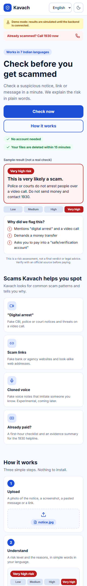
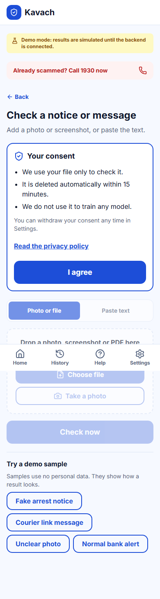
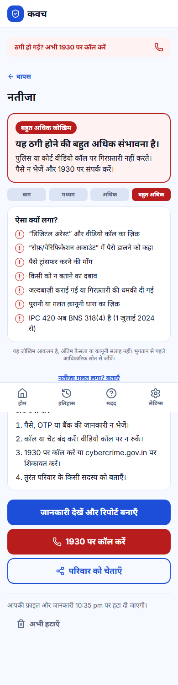
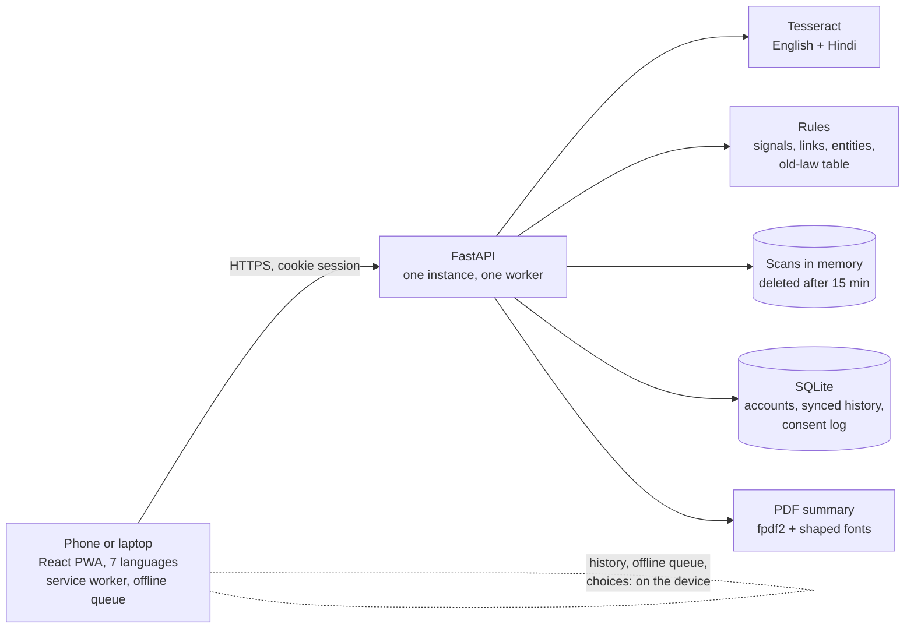

# Kavach

**Check a suspicious notice, link or message before you pay.** Kavach gives a **risk level and the
reasons**, in seven Indian languages, and builds a one-page summary to read out to the **1930**
cybercrime helpline. It never says "this is a scam": it is a risk assessment, not a verdict or legal
advice. It is built for the "digital arrest" and "safe account" frauds, where a caller threatens
arrest on a video call and demands money.

<p>
  
  
  
</p>

**Status: working software, not yet live.** It runs locally and in a container, and is tested in
three browser engines, but it has no public address (that needs a domain, a host and a mail service),
no real person has used it, and the numbers below come from messages the team wrote. See "What is
not done" before you rely on anything here.

- **Try it in two minutes:** [`docs/demo-script.md`](docs/demo-script.md) (script, fallbacks, a backup video
  plan). Made-up sample notices to upload are in [`samples/`](samples/README.md).
- **How well does it work?** [`docs/benchmarks.md`](docs/benchmarks.md): measured, with what the
  numbers do not show. No accuracy figure is claimed for the product.

## What it does

- **Check** a photo, screenshot, PDF, pasted text or link. Text is read from photos with Tesseract
  (English and Hindi); a fixed set of readable rules decides the level (low, medium, high, very high,
  or "cannot verify") and lists the reasons it used. There is no AI model in the loop, so the reasons
  shown are exactly the reasons used.
- **Names the old law:** a notice that quotes the IPC or CrPC is flagged, and the section that replaced
  it since 1 July 2024 is shown (only the most-quoted sections are in the table, still to be checked
  against the gazette).
- **Evidence summary:** the person confirms the details it read (amount, UPI id, phone, UTR) and gets a
  PDF with the details, fingerprints (SHA-256) of the evidence and a script to read to the helpline.
- **Privacy by design:** consent first, in plain words; a check lives 15 minutes in the server's
  memory and is never written to disk; guest mode needs no account; history stays on the phone
  unless the person turns on sync; one button deletes everything.
- **Seven languages** (English, Hindi, Bengali, Marathi, Tamil, Telugu, Gujarati), light and dark
  themes, large text and high contrast. The non-English text is a draft that still needs native
  readers.
- **A real app on a weak connection:** installs to the home screen, opens with no internet, says what
  works, keeps a check typed while offline and sends it when the connection returns (only while the
  app is open), makes big photos smaller to save data, and accepts shared messages from other apps
  ([ADR-0005](docs/decisions/ADR-0005-pwa-and-offline.md)).

## How it is built



| Part | Choice | Why |
|---|---|---|
| Website | React 19, Vite, TypeScript, Tailwind v4, i18next, TanStack Query | One codebase for website and installable app; English is the only language in the first download |
| Backend | FastAPI, one worker, SQLite | A scan never touches disk, so "deleted after 15 minutes" is simple to keep true ([ADR-0004](docs/decisions/ADR-0004-launch-architecture.md)) |
| Detection | Rules (regular expressions over normalised text), no model | Reasons must be the real reasons; see [ADR-0002](docs/decisions/) |
| Reading photos | Tesseract, with straightening and enlarging of small or tilted photos | Measured: wrong characters on a tilted photo 41% → 7% ([benchmarks](docs/benchmarks.md)) |
| Sign-in | Emailed one-time link; guests need nothing | No passwords to leak |
| Offline | Hand-written service worker, IndexedDB queue | Privacy rules are easy to read and test ([ADR-0005](docs/decisions/ADR-0005-pwa-and-offline.md)) |

Everything about *why* is in [`docs/decisions/`](docs/decisions/); the API is in
[`docs/api-contract.md`](docs/api-contract.md).

## Run it

Frontend (Node 22+):

```bash
cd microservices/frontend
cp .env.example .env.local        # VITE_API_URL=http://localhost:8000 uses the real backend; leave it out for the demo
npm install
npm run dev                       # http://localhost:5173
```

Backend (Python 3.13, Tesseract with English and Hindi installed):

```bash
cd microservices/backend
python -m venv .venv
.venv/Scripts/activate            # Windows; macOS/Linux: source .venv/bin/activate
pip install -r requirements-dev.txt
cp .env.example .env
uvicorn app.main:app --reload --no-access-log     # http://localhost:8000/health
```

The demo website (no backend) works on its own and shows a "Demo mode" banner: its results are
simulated, which is the only version that works with no Tesseract.

In a container: `docker build -t kavach-backend microservices/backend` (not built on the author's
machine; CI builds it). Deploying for real: [`docs/deploy.md`](docs/deploy.md).

## Tests

| What | Where | Count |
|---|---|---|
| Backend (rules, files, abuse and security, accounts, backups, evaluation guard) | `microservices/backend/tests`, `pytest` | 454 |
| Frontend units (translations, offline queue, image shrinking, worker rules, API client) | `microservices/frontend`, `npm test` | 183 |
| Browser, three engines (Chromium, Firefox, WebKit) at phone size: public pages, demo flow, Hindi, axe accessibility, install and offline | `npm run test:browsers` | 46 tests × 3 |
| Browser, Edge, real backend: photo to Hindi result, accounts, checks kept offline, speed on a slow phone, accessibility on 39+ screens, pages written out in advance | `microservices/tests/e2e/run.ps1` (Windows) | 8 suites |
| Lint, types, formatting, dependency audit (0 known vulnerabilities) | CI: `.github/workflows/ci.yml` | |

CI runs the first three, plus lint and the container build; it has not been seen running on GitHub
yet.

## How well does it work?

Only measured on messages **the team wrote** (240 items, no real person's message), so treat the
numbers as a way to find bugs, not as a promise:

- On a fresh set written without looking at the rules, the rules warned about **73%** of the scams
  they are written for (19 of 26) and answered "low risk" about 7 of them. After fixing what that
  showed it is 92%, which is no longer a fair test. The older sets (which the rules were tuned on)
  said 100%, and were wrong about how well it generalises.
- About a quarter of honest messages are warned about too, mostly awareness posts ("beware of digital
  arrest") and friends asking for money. A rule to avoid that would let scammers evade the check, so it
  was not added.
- Photos: the whole path (draw, spoil, read, judge) is measured on drawn text, which is easier than
  real photos. A check takes about 0.3 s of one core.
- Speed: the landing page paints in about 0.7 s on a simulated slow phone and network
  (Fast 3G, 4× slower processor).

Details, intervals, every mistake: [`docs/benchmarks.md`](docs/benchmarks.md).

## What is not done

- **Not live.** Needs a domain, a host, a mail service ([`docs/deploy.md`](docs/deploy.md)).
- **No real users, no usability test** ([`docs/usability-test.md`](docs/usability-test.md) is the kit),
  **no real phone** ([`docs/phone-test.md`](docs/phone-test.md) is the checklist).
- **Legal text and translations** are drafts: a lawyer and native speakers must read them.
- **Rules, not a model:** new scam scripts will be missed; out-of-scope scams (lottery, jobs,
  investment, sextortion) are mostly missed or weakly flagged.
- **Voice scan, a B2B developer portal, an admin panel, a native app** are later.
- **One instance, SQLite:** fine for launch; the point at which to move is in ADR-0004.
- **No outside security review.** See [`SECURITY.md`](SECURITY.md).

## Repo layout

| Folder | Purpose |
|---|---|
| `microservices/frontend` | React + Vite website and installable app; Playwright tests in `browser-tests/` |
| `microservices/backend` | FastAPI backend; `evaluation/` holds the labelled sets and the measuring code |
| `microservices/tests` | Edge end-to-end suites (`e2e/run.ps1`) and cross-module tests |
| `microservices/database`, `ml`, `infra` | Pointers: the schema is in the backend, evaluation code in `backend/evaluation`, deploy files next to what they build |
| `samples` | Made-up demo notices, clearly marked, with what Kavach says about each |
| `docs` | Decisions, API contract, benchmarks, deploy runbook, demo script, test kits, [pitch notes](docs/pitch.md), [resume bullets](docs/resume-bullets.md) |
| `build-phases` | The nine build steps, with what is and is not done in each |
| `design-mockups` | UI mockups (Option A "Calm Trust" is the chosen design) |

The planning documents (master document, roadmap, architecture, market notes) are in the repository
root.

## Rules

- No secrets in the repo; only `.env.example` files are committed.
- User uploads are never committed or stored beyond the short TTL.
- Claims (accuracy, speed) are published only after they are measured, with their limits.
